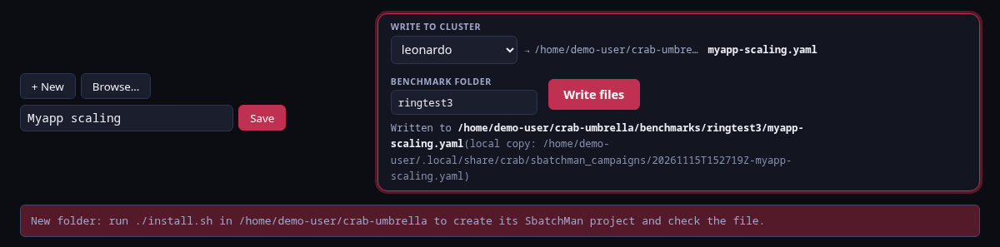

# Write a campaign

A campaign is a jobs file that SbatchMan launches. Write one by hand, or in the `crab web` dashboard.

## Before you start

- The umbrella installed on the cluster (see [Install](install.md)), with `source env.sh` run in your shell.
- A benchmark you can run (see [Register a benchmark](benchmarks.md)).

## Add your config

The jobs file names a SbatchMan config, which holds the modules and the GPUs of its jobs. Skip this section if `crab_run_{nodes}` (CPU) fits your application.

1. Add a block under `configs:` in `configs/leonardo.yaml`. Edit the template, never the filled copy in `.local/`.

   ```yaml
       - name: "myapp_{nodes}"
         nodes: "{nodes}"
         gpus: 4                # drop this line for a CPU-only application
         modules:
           - "some-module"      # include one that puts mpirun on PATH
   ```

2. Refill the copy:

   ```bash
   ./install.sh
   ```

The name is what a job writes in its `config:` key. Every `nodes` value a job uses must be in the `nodes` list at the top of the template.

## Write the jobs file by hand

1. Make the folder `benchmarks/<benchmark>`. It sits two levels under the umbrella root, because the file loads `../../.local/configs.leonardo.yaml`.
2. Save this file in it as `<job>.yaml`. It is `benchmarks/blink/smoke.yaml` without the comments.

   ```yaml
   configs: ../../.local/configs.leonardo.yaml
   variables:
     nodes:
       - 2
   jobs:
     - config: crab_run_{nodes}
       tag: a2a-smoke-{nodes}
       preprocess: |
         mkdir -p "$SBATCHMAN_JOB_DIR"
         cat > "$SBATCHMAN_JOB_DIR/config.json" <<'JSON'
         {
           "schema_version": 2,
           "global_options": {"numnodes": "{nodes}", "ppn": "4", "name": "a2a-smoke-{nodes}"},
           "experiments": {
             "run": {
               "apps": {
                 "0": {"path": "blink/alltoall/alltoall_b.py", "args": "-msgsize 1048576 -iter 100",
                       "collect": true, "start": "0", "end": ""}
               }
             }
           }
         }
         JSON
       command: crab worker --workdir "$SBATCHMAN_JOB_DIR"
   ```

3. Change the keys of the jobs file you need:

   | Key | Meaning |
   |---|---|
   | `variables` | SbatchMan runs one job per value. Write `{nodes}` where the value goes. |
   | `config` | The name of a config in the configs file. |
   | `tag` | The job name and its result folder. Keep it equal to `"name"` in the JSON. |

4. Change the keys of the CRAB JSON you need. [The commented template](https://github.com/HLC-Lab/crab-sbatchman/blob/main/templates/jobs-template.yaml) says what to change in each.

   | Key | Meaning |
   |---|---|
   | `"schema_version"` | The format of the file. Keep `2`. |
   | `"global_options"` | The settings of the whole job: `"numnodes"`, `"ppn"` and `"name"`. |
   | `"numnodes"` | The nodes of the job, from `{nodes}`. Stay within the config's `nodes`. |
   | `"ppn"` | The ranks per node of each app. Stay within the config's `tasks_per_node`. |
   | `"name"` | The name of the run. Keep it equal to `tag`. |
   | `"experiments"` | One entry per experiment. They run one after another, in sorted name order. |
   | `"apps"` | The applications of an experiment, keyed `"0"`, `"1"` and so on. They run together in every run. |
   | `"path"` | The wrapper of the app, such as `myapp/myapp.py` for a wrapper made with `crab wrappers new myapp`. |
   | `"args"` | The command-line flags of the app. |
   | `"collect"` | `true` stores the app's metrics, `false` skips them. Use `false` for noise apps. |
   | `"start"` | The delay in seconds before the app starts, or `"s0"` to start when app 0 has finished. |
   | `"end"` | `""` waits for the app to finish, `"f"` stops it when the other apps have finished. |

5. Run `./install.sh` once more. It runs `sbatchman init` in the new folder and checks every jobs file with `crab validate`.

Write the heredoc marker quoted (`<<'JSON'`) so the shell leaves the JSON as it is. Write `$SBATCHMAN_JOB_DIR` for the job folder: SbatchMan does not replace `{EXP_DIR}` there. To co-run applications, add apps `"1"`, `"2"` with a `partition`, as in `benchmarks/blink/blink-noise.yaml`.

Check the file without submitting anything:

```bash
cd benchmarks/<benchmark> && sbatchman launch -f <job>.yaml --dry-run
```

## Write it in the dashboard

The dashboard writes the jobs file into a benchmark folder of the umbrella on the cluster, and keeps a copy on your laptop. It does not launch the jobs.

1. Connect the cluster as in [Connect](connect.md#add-the-cluster-in-crab-web), then open **SbatchMan**.
2. Type the campaign name in the field next to **Save**. The file is that name in lower case with dashes, such as `myapp-scaling.yaml`.
3. Under **Write to cluster**, pick the cluster. In **Benchmark folder**, pick a folder of `benchmarks/`, or type a new name to make one. Empty uses the first folder.
4. In **Group**, fill **Tag**, **SbatchMan config**, **Nodes** and **Processes per node**. **SbatchMan config** suggests the names in `.local/configs.<cluster>.yaml`.
5. Under **Variables**, press **+ Add variable**. Give a name and comma-separated values.
6. Under **Experiment**, press **+ Add app**, then **Choose wrapper…**, pick a wrapper and write its args. **+ Add attribute** sets a key the wrapper reads. Press **+** beside **Groups** for another group.
7. Press **Write files**. If a problem count shows beside it, press the count to see what blocks the write. The page then shows the path it wrote.
8. If the page says `New folder`, run `./install.sh` on the cluster. It runs `sbatchman init` there and checks the file. Then run the `--dry-run` command of [Write the jobs file by hand](#write-the-jobs-file-by-hand) in `benchmarks/<benchmark>`.




The file starts with `configs: ../../.local/configs.<cluster>.yaml`. Fill **Configs file** under **Campaign settings** only to name another configs file. A group with a shell variable such as `$CRAB_ROOT` in a wrapper attribute gets an unquoted `<<JSON` heredoc, so the shell expands it.

Next: [Run a benchmark](launch.md).
