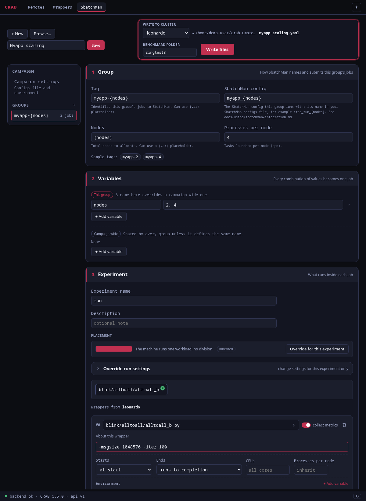

# Write the jobs file

A jobs file is the YAML file that SbatchMan launches: which jobs to run, on how many nodes, and what each job runs. Write it by hand on the cluster login node, or in the `crab web` dashboard on your laptop. Both give the same file.

## Before you start

- The umbrella installed on the cluster (see [Install](install.md)), with `source env.sh` run in your shell.
- A benchmark you can run: Blink (see [Run a benchmark](launch.md)) or your own (see [Wrap and register your benchmark](benchmarks.md)).

The jobs file names a SbatchMan config, which holds the modules and the GPUs of its jobs. If `crab_run_{nodes}` (CPU) does not fit your application, add a config first: [Add your config](presets.md#add-your-config).

## By hand

### Save the file

Make the folder `benchmarks/<benchmark>`. It sits two levels under the umbrella root, because the file loads `../../.local/configs.leonardo.yaml`. Save this file in it as `<job>.yaml`. It is `benchmarks/blink/smoke.yaml` without the comments.

```yaml
configs: ../../.local/configs.leonardo.yaml
variables:
  nodes:
    - 2
jobs:
  - config: crab_run_{nodes}
    tag: a2a-smoke-{nodes}
    preprocess: |
      mkdir -p "$SBATCHMAN_JOB_DIR"
      cat > "$SBATCHMAN_JOB_DIR/config.json" <<'JSON'
      {
        "schema_version": 2,
        "global_options": {"numnodes": "{nodes}", "ppn": "4", "name": "a2a-smoke-{nodes}"},
        "experiments": {
          "run": {
            "apps": {
              "0": {"path": "blink/alltoall/alltoall_b.py", "args": "-msgsize 1048576 -iter 100",
                    "collect": true, "start": "0", "end": ""}
            }
          }
        }
      }
      JSON
    command: crab worker --workdir "$SBATCHMAN_JOB_DIR"
```

For the toy `myapp` of [Wrap and register your benchmark](benchmarks.md), use `myapp` as `<benchmark>` and save this as `benchmarks/<benchmark>/smoke.yaml`. The toy takes no flags, so `"args"` is empty:

```yaml
configs: ../../.local/configs.leonardo.yaml
variables:
  nodes:
    - 2
jobs:
  - config: crab_run_{nodes}
    tag: myapp-smoke-{nodes}
    preprocess: |
      mkdir -p "$SBATCHMAN_JOB_DIR"
      cat > "$SBATCHMAN_JOB_DIR/config.json" <<'JSON'
      {
        "schema_version": 2,
        "global_options": {"numnodes": "{nodes}", "ppn": "4", "name": "myapp-smoke-{nodes}"},
        "experiments": {
          "run": {
            "apps": {
              "0": {"path": "myapp/myapp.py", "args": "", "collect": true, "start": "0", "end": ""}
            }
          }
        }
      }
      JSON
    command: crab worker --workdir "$SBATCHMAN_JOB_DIR"
```

For your own application, change `myapp` to the name of your benchmark in `tag` and `"name"` (they stay equal), and to your wrapper in `"path"`. Change `"args"` to your flags, and `nodes` and `"ppn"` to values that your config allows. [Change the keys](#change-the-keys) explains each.

### Change the keys

Change the keys of the jobs file you need:

| Key | Meaning |
|---|---|
| `variables` | SbatchMan runs one job per value. Write `{nodes}` where the value goes. |
| `config` | The name of a config in the configs file. |
| `tag` | The job name and its result folder. Keep it equal to `"name"` in the JSON. |

Change the keys of the CRAB JSON you need. [The commented template](https://github.com/HLC-Lab/crab-sbatchman/blob/main/templates/jobs-template.yaml) says what to change in each.

| Key | Meaning |
|---|---|
| `"schema_version"` | The format of the file. Keep `2`. |
| `"global_options"` | The settings of the whole job: `"numnodes"`, `"ppn"` and `"name"`. |
| `"numnodes"` | The nodes of the job, from `{nodes}`. Stay within the config's `nodes`. |
| `"ppn"` | The ranks per node of each app. Stay within the config's `tasks_per_node`. |
| `"name"` | The name of the run. Keep it equal to `tag`. |
| `"experiments"` | One entry per experiment. They run one after another, in sorted name order. |
| `"apps"` | The applications of an experiment, keyed `"0"`, `"1"` and so on. They run together in every run. |
| `"path"` | The wrapper of the app, such as `myapp/myapp.py` for the wrapper of [Wrap and register your benchmark](benchmarks.md). |
| `"args"` | The command-line flags of the app. |
| `"collect"` | `true` stores the app's metrics, `false` skips them. Use `false` for noise apps. |
| `"start"` | The delay in seconds before the app starts, or `"s0"` to start when app 0 has finished. |
| `"end"` | `""` waits for the app to finish, `"f"` stops it when the other apps have finished. |

Write the heredoc marker quoted (`<<'JSON'`) so the shell leaves the JSON as it is. Write `$SBATCHMAN_JOB_DIR` for the job folder: SbatchMan does not replace `{EXP_DIR}` there. To co-run applications, add apps `"1"`, `"2"` with a `partition`, as in `benchmarks/blink/blink-noise.yaml`.

### Check the file

Only the installer validates the CRAB JSON in a jobs file. It runs `sbatchman init` in the new folder. Then, for each `benchmarks/*/*.yaml` file, it fills in the `variables`, takes the JSON out of the `<<JSON` heredoc and runs `crab validate` on it. It checks the first and the last combination of the variables, and `--full-check` checks them all. A wrong `"path"` or invalid JSON fails there. It does not catch a misspelled key, or a `config`, `tag` or `nodes` value that your config does not have: the dry run on the cluster catches the `config` and `nodes` values. Do not run `crab validate` on the jobs file yourself: the command reads a CRAB JSON file, and fails on the YAML with `not valid JSON`.

On a laptop, run the installer with the laptop role. A bare `./install.sh` there installs the cluster role (see [Another cluster](presets.md#another-cluster)):

```bash
./install.sh --role laptop 2>&1 | grep -E 'jobs file|install.sh:'
```

The command runs in the umbrella folder and prints one line for each jobs file and the verdict. A good result has `OK jobs file benchmarks/<benchmark>/<job>.yaml passes crab validate` for your file and ends with `install.sh: all checks passed`. A failure prints `FAIL jobs file` with the reason. The `grep` hides other errors and the exit code: without the line `install.sh: all checks passed`, run the command again without the `grep`.

On the cluster, run `./install.sh` for the same check. Then check what SbatchMan would submit, without submitting anything:

```bash
cd benchmarks/<benchmark> && sbatchman launch -f <job>.yaml --dry-run
```

Run the dry run on the cluster only. On a laptop it stops with `Configuration file ../../.local/configs.leonardo.yaml does NOT exist`, because only the cluster install writes that file.

## In the dashboard

The dashboard writes the same file into a benchmark folder of the umbrella on the cluster, and keeps a copy on your laptop. It does not launch the jobs. Each field writes a key of [the tables](#change-the-keys), whose rows say what the key means.

1. In `crab web` on your laptop, connect the cluster as in [Connect](connect.md#add-the-cluster-in-crab-web), then open **SbatchMan**.
2. Type the campaign name in the field next to **Save**. The file is that name in lower case with dashes, such as `myapp-scaling.yaml`.
3. Under **Write to cluster**, pick the cluster. In **Benchmark folder**, pick a folder of `benchmarks/`, or type a new name to make one. Empty uses the first folder.
4. In **Group**, fill **Tag**, **SbatchMan config**, **Nodes** and **Processes per node**. They write `tag`, `config`, `"numnodes"` and `"ppn"`. The config field suggests the names in `.local/configs.leonardo.yaml`, the one name the installer writes ([Another cluster](presets.md#another-cluster)).
5. In the **Variables** card, press **+ Add variable** under **This group** for one group or under **Campaign-wide** for every group. Give a name and comma-separated values. They write `variables`.
6. Under **Experiment**, press **+ Add app**, then **Choose wrapper…**, pick a wrapper and write its args. They write `"path"` and `"args"`. The app's **collect metrics**, **Starts** and **Ends** write `"collect"`, `"start"` and `"end"`. **+ Add attribute** sets a key the wrapper reads. Press **+** beside **Groups** for another group.
7. Press **Write files**. If a problem count shows beside it, press the count to see what blocks the write. The page then shows the path it wrote.
8. On the cluster, follow [Check the file](#check-the-file). If the page said `New folder`, the `./install.sh` run is required: it makes the folder a SbatchMan project.




The file starts with `configs: ../../.local/configs.leonardo.yaml`, for every cluster (see [Another cluster](presets.md#another-cluster)). Fill **Configs file** under **Campaign settings** only to name another configs file. A group with a shell variable such as `$CRAB_ROOT` in a wrapper attribute gets an unquoted `<<JSON` heredoc, so the shell expands it.

Next: [Run a benchmark](launch.md).
