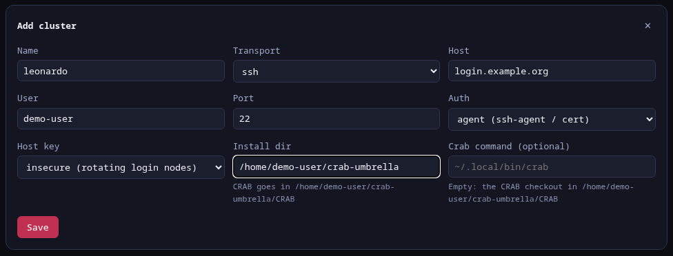

# Connect the laptop to the cluster

The cluster is registered in two places, because two tools use it. The dashboard keeps its own cluster profile: it browses the cluster, writes jobs files there and shows the state of your jobs. SbatchMan reads `remotes-config.toml` and uses it to copy the results to your laptop; the dashboard does not write that file.

Both need the same three values: the address you ssh to, your username there and the port. Replace `<login-host>` with the address and `<your-user>` with the username. Install the umbrella on the cluster and on your laptop first, as in [Install](install.md).

## Add the cluster in crab web

1. In the umbrella folder, run `source env.sh`: the `crab` command lives in its virtual environment. Then start the dashboard on your laptop, not on the cluster, from the shell that holds your ssh agent. It finds the agent through `SSH_AUTH_SOCK`. Other users of a shared machine can reach the dashboard. It opens `http://127.0.0.1:8899`.

   ```bash
   source env.sh
   crab web
   ```

2. Open **Remotes** and press **+ Add cluster**.
3. Fill in the fields.

   | Field | Value |
   |---|---|
   | Name | `leonardo` |
   | Transport | `ssh` |
   | Host, User | `<login-host>`, `<your-user>` |
   | Port | `22` |
   | Auth | agent (ssh-agent / cert) |
   | Host key | strict (for rotating login nodes, see [Known limits](reference.md#known-limits)) |
   | Install dir | `<umbrella-dir>`, the folder where you cloned the umbrella on the cluster |
   | Crab command | Empty |

4. Press **Save**.
5. Press **Connect** next to the cluster. The dot turns green and the button says **Disconnect**.



If Connect says no SSH key is loaded in your agent, log in the way you do for the cluster, for example with `ssh-add`, in the shell that runs `crab web`. Then start `crab web` again.
Host key `strict` checks your `~/.ssh/known_hosts`. Run `ssh <login-host>` once first, so the file holds the host key.

Do not press **Install CRAB** for this cluster: the umbrella already installed it.
If a profile with that name exists, the form says so under Name and Save stays off: pick another name.

## Add the cluster to SbatchMan

Save this as `remotes-config.toml` in the SbatchMan config folder on your laptop, or add it by hand to the file if it exists. The folder is `~/.config/sbatchman/` on Linux and `~/Library/Application Support/sbatchman/` on macOS.

```toml
[[clusters]]
name = "leonardo"
host = "<login-host>"
port = 22
user = "<your-user>"
```

[Results](results.md#fetch-and-plot) shows this same block with `fetch_dirs` lines and a `[global]` section added. Do not paste its second `[[clusters]]` block: add its `fetch_dirs` lines under the block you saved. Add its `[global]` section once. If the file already has a `[global]` section, edit that one.

Next: [Register a benchmark](benchmarks.md), then [Launch and follow jobs](launch.md).
