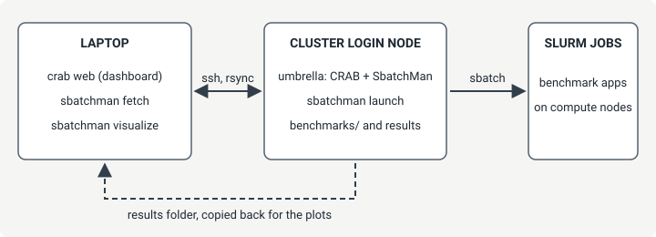

# Start here

CRAB benchmarks co-running HPC applications on a Slurm cluster. SbatchMan creates, launches and monitors the Slurm jobs that run them.
This repo, the umbrella, installs both at matching versions and ships example benchmarks.

## What you need

- A login on Leonardo and a Slurm account you can charge.
- A laptop that can ssh to the login node.
- Python 3.11 or newer on the cluster and on the laptop.
- git on both.

## Two ways to use it

Run a benchmark that is already here: Blink is in `benchmarks/blink`, and [Register a benchmark](benchmarks.md) lists the others that `crab setup` offers.
Or add your own application, with a wrapper and a jobs file.

## Reading order

1. [Install](install.md): put the umbrella on the cluster and on your laptop.
2. [Connect](connect.md): tell the dashboard and SbatchMan where the cluster is.
3. [Launch and follow jobs](launch.md): submit the jobs of a benchmark. Blink needs [registering](benchmarks.md#register-a-supported-benchmark) first.
4. Add your benchmark: [Register a benchmark](benchmarks.md), then [Write a campaign](campaigns.md).
5. [Results](results.md): copy the results to your laptop and plot them.
6. [Reference](reference.md): look up the installer options, the files of the repo and the words the docs use.
7. [Troubleshooting](troubleshooting.md): find the message of a failed step and what to do about it.
