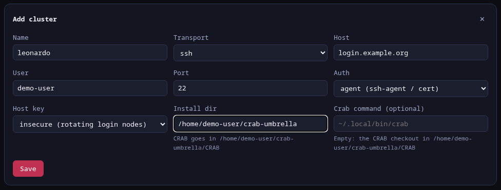

# Install

## Before you start

- A login on Leonardo. The shipped Slurm configuration is for that cluster.
- Python 3.10 or newer. On a cluster this is a module, such as `module load python`. On a Mac, install it from python.org or Homebrew.
- git.
- A Slurm account you can charge.

## Install on the cluster

On a login node:

```bash
git clone --recurse-submodules https://github.com/HLC-Lab/crab-sbatchman.git
cd crab-sbatchman
module load python
./install.sh --account <YOUR_ACCOUNT>
source env.sh
```

Replace `<YOUR_ACCOUNT>` with the Slurm account to charge.

The installer checks the account first, with `sacctmgr` when it is on `PATH`. Add `--skip-account-check` if the lookup is wrong for your site. The installer saves the account, so later runs need no `--account`. Run `source env.sh` in every new shell. Add `--dry-run` to print the commands without running them.

The install ends with a self-check that submits no job. A pass prints `install.sh: all checks passed`. If a check fails, see [Troubleshooting](troubleshooting.md).

Register the benchmarks you run in [Register a benchmark](benchmarks.md).

## Install on your laptop

Optional: install the umbrella on your laptop, to run the dashboards there.

```bash
git clone --recurse-submodules https://github.com/HLC-Lab/crab-sbatchman.git
cd crab-sbatchman
./install.sh --role laptop
source env.sh
```

`crab web` serves the dashboard on port 8899. `sbatchman visualize` serves the result plots on port 8765.

## Connect your cluster in crab web

1. Start the dashboard from the shell that holds your ssh agent. It finds the agent through `SSH_AUTH_SOCK`.

   ```bash
   crab web
   ```

2. Open **Remotes** and press **+ Add cluster**.
3. Fill in the fields. Replace `<login-host>` with the address you ssh to and `<your-user>` with your username there.

   | Field | Value |
   |---|---|
   | Name | `leonardo` |
   | Transport | `ssh` |
   | Host, User | `<login-host>`, `<your-user>` |
   | Port | `22` |
   | Auth | agent (ssh-agent / cert) |
   | Host key | strict (for rotating login nodes, see [Known limits](reference.md#known-limits)) |
   | Install dir | `<umbrella-dir>`, the folder where you cloned the umbrella on the cluster |
   | Crab command | Empty |



Do not press **Install CRAB** for this cluster: the umbrella already installed it.
If a profile with that name exists, the form says so under Name and Save stays off: pick another name.

## Update

```bash
git pull
git submodule update --init
./install.sh
```

On a laptop, run `./install.sh --role laptop` instead: a bare `./install.sh` runs the cluster role.

Do not run `crab update` in the umbrella: it pins CRAB and the wrappers to tested commits.
